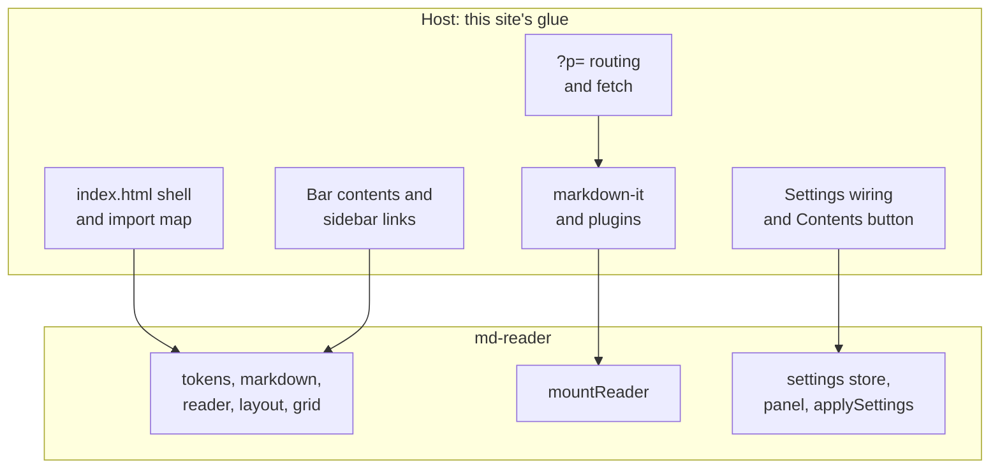

# The app around it

md-reader is not an app. Everything on this site that is not the reading layer is glue that the site writes itself, in three files: [index.html](https://github.com/frycz/md-reader/blob/main/index.html), [site/site.js](https://github.com/frycz/md-reader/blob/main/site/site.js) and [site/site.css](https://github.com/frycz/md-reader/blob/main/site/site.css). Another host, such as view-md or the blog, writes its own version of each piece.



*Top: what this site writes. Bottom: what it imports.*

## What the host writes

- **The HTML shell.** The `mdr-header` and `mdr-layout` markup, the stylesheet links, and an import map that tells the browser where `highlight.js` and `mermaid` come from. md-reader imports them by package name and does not care where they come from.
- **The theme bootstrap.** An inline `<script>` in `<head>`, the string `themeBootstrap(key)` returns, so the saved theme is applied before the first paint.
- **Getting the document.** Choosing a page from `?p=`, fetching its `.md` file, and showing an error if that fails. md-reader never loads anything.
- **Rendering.** markdown-it, with plugins for footnotes and task lists. md-reader has no parser and starts from the HTML.
- **The bar's contents.** The site name, page title, Contents button, ⚙ button and GitHub link. md-reader styles the bar and its buttons but never fills it.
- **Navigation.** The sidebar links, and the copies that move into the bar below 760px when `grid.css` hides the sidebar.
- **Settings wiring.** Choosing which fields the panel shows, and what happens when one changes: apply, save, sync, and redraw diagrams or rebuild the contents when needed.
- **The Contents toggle.** Flipping `data-toc="off"` on the layout. md-reader defines what the attribute does, and the host decides what flips it.
- **Small fixes.** Hiding the rail on a page with no headings, writing the current heading into the URL hash, and scrolling to the hash once the document has loaded, because the browser looked for it before the document existed.

## What that looks like

The settings glue is the biggest piece. The panel only reports what changed, and the host decides what to do with it:

```js
const store = createSettingsStore({ key: "md-reader-showcase", persist: FIELDS });
let settings = store.load();
applySettings(settings);

const panel = createSettingsPanel({
  settings,
  fields: FIELDS,
  onChange(patch) {
    const prev = settings;
    settings = { ...settings, ...patch };
    applySettings(settings);
    store.save(settings);
    panel.sync(settings);
    if (settings.theme !== prev.theme) void reader?.redrawDiagrams();
    if (settings.tocDepth !== prev.tocDepth) reader?.toc?.rebuild(settings.tocDepth);
  },
});
bindPopover(settingsBtn, panel.el);
```

Loading and mounting a document. Rendering is the host's choice, and the rest is one call:

```js
const res = await fetch(page.src);
content.innerHTML = md.render(await res.text());

reader = mountReader({
  content,
  tocList: document.querySelector(".mdr-toc-list"),
  tocDepth: settings.tocDepth,
  onNavigate: (id) => history.replaceState(null, "", `#${id}`),
});

// A page with nothing to list gives its rail's column back to the text.
tocRail.hidden = !(reader.toc?.count() > 0);
```

The host's CSS has one required line, the bar's height, because the rails, the heading scroll margin and the scroll spy all measure from it. The rest of `site.css` styles the things the host put in the bar and the sidebar:

```css
:root {
  --header-h: 52px;
}
```
