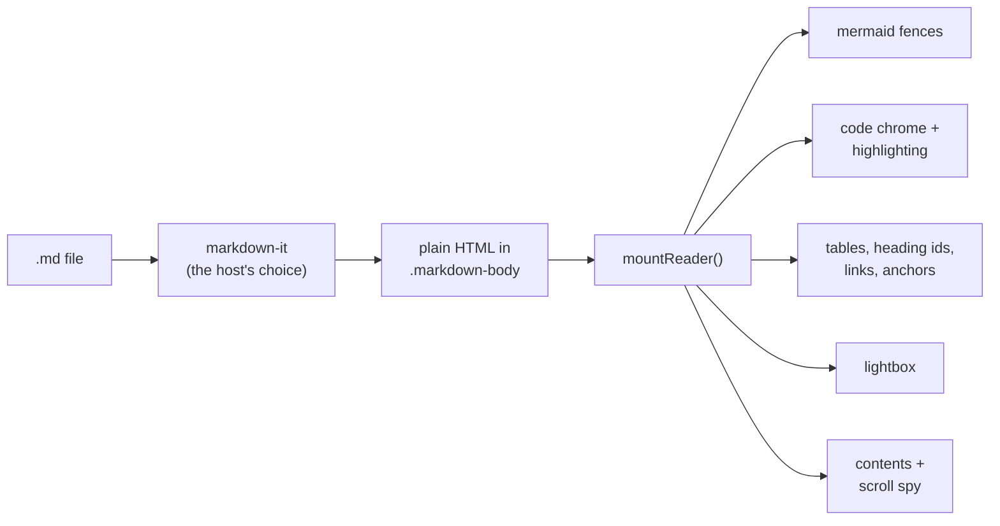
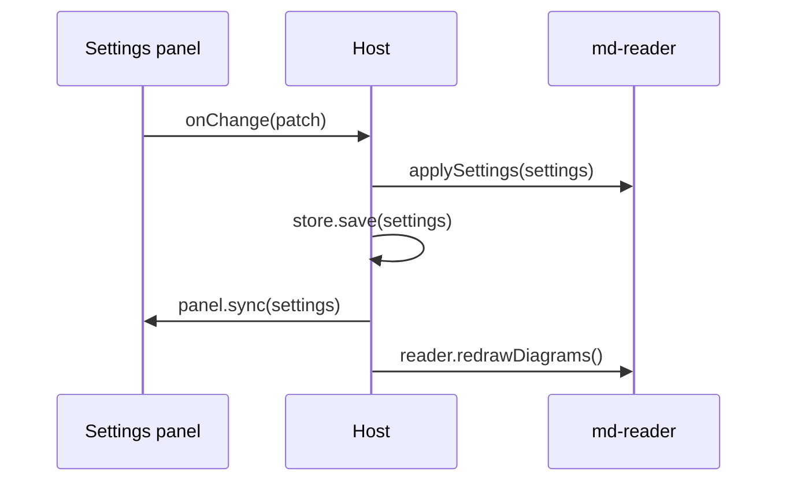
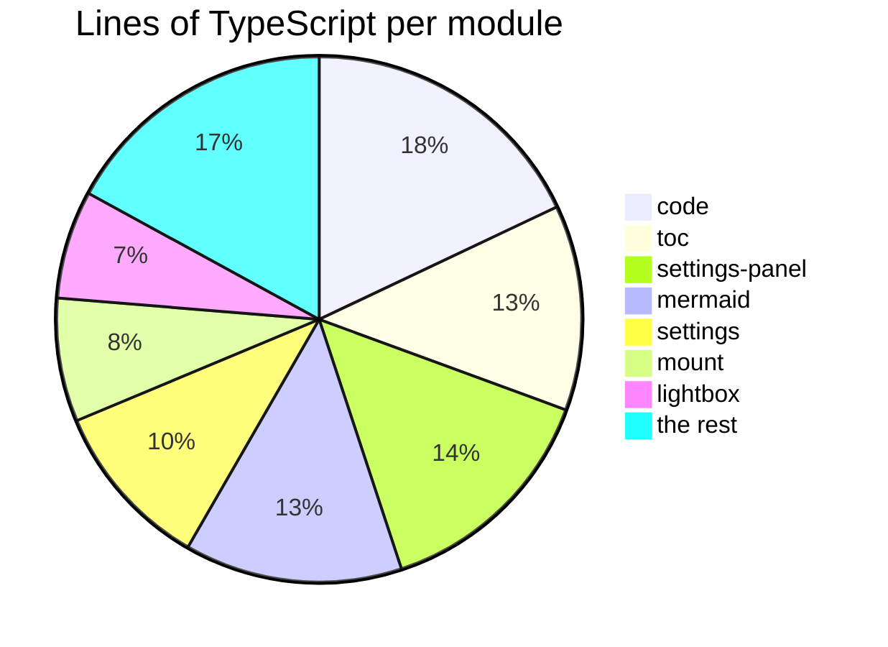

# Showcase

md-reader is the reading layer for markdown that something else has already rendered. It brings theme tokens, a stylesheet for `.markdown-body`, and DOM passes that add a table of contents, code block chrome, mermaid diagrams and a lightbox. It has no parser, no framework and no server.

This page is the proof. It is a plain markdown file that the site renders with markdown-it, and then a single `mountReader` call does everything else you see. Try the controls while you read:

- **⚙ in the bar** opens the settings panel from `createSettingsPanel`, with theme, font, size, width and contents depth.
- **Contents** collapses the rail on the right, which is `data-toc="off"` on `.mdr-layout`.
- **The rail** follows your scroll, and clicking an entry scrolls to it.
- **Narrow the window** and the rail goes below 1100px, the sidebar below 760px.

## How a page gets here



*The pipeline behind this page. Click the diagram to open it full screen.*

The order matters. Mermaid fences are taken out first so that the code pass does not wrap them as code blocks, and heading ids are assigned before the contents are built from them.

## Typography

Body text is set in `--font-body` at `--font-size`, with a line height of 1.7. Switch the content font to monospace in the settings and the whole document changes with it, inline code included.

Text can be *emphasised*, **strong**, ***both***, ~~struck through~~, or `inline code`. Superscript and subscript sit on the line without pushing it apart: E = mc<sup>2</sup>, H<sub>2</sub>O. A <mark>highlighted passage</mark> uses `--mark-bg`.

Links come in two kinds. [An in-page link](#code-blocks) scrolls smoothly and stays under the bar, thanks to `bindAnchorLinks` and `scroll-margin-top`. [An external link](https://github.com/frycz/md-reader) gets `target="_blank"` and `rel="noopener"` from `markExternalLinks`. A bare URL such as https://github.com/frycz/view-md is linkified by markdown-it and then treated the same way.

Search belongs to the host, but the color of a hit is part of the theme: this is a <mark class="search-hit">search hit</mark>, and this is the <mark class="search-hit current">current hit</mark>.

---

A horizontal rule is a single line in `--border`.

## Headings

Every heading gets a slugged id from `assignHeadingIds`, so build-time rendered markdown needs no anchor plugin. Repeated text gets a suffix, as in `install` and then `install-1`, the same rule that `createSlugger` gives to a renderer that makes its own ids. Set the contents depth to h1–h6 in the settings to see all of the levels below appear in the rail.

### Third level

#### Fourth level

##### Fifth level

###### Sixth level

## Lists

- Unordered lists indent by `1.6em`
- with a little space between items
  - and nested lists
  - that keep the same rhythm
- back at the top

1. Ordered lists
2. work the same way
   1. including nested
   2. ordered lists

Task lists come from a markdown-it plugin, and the stylesheet knows `.task-list-item`:

- [x] Render the markdown
- [x] Call `mountReader`
- [ ] Write a host-specific feature

## Blockquotes

> A blockquote is muted text behind a rule in `--border`.
>
> It can hold more than one paragraph, and **anything else** markdown allows.

## Tables

`wrapTables` puts every table in a `.table-wrap`, so a wide one scrolls on its own instead of widening the page.

| Pass | Function | Skipped with | What it does |
| --- | --- | --- | --- |
| Mermaid | `upgradeMermaidFences`, `renderDiagrams` | `mermaid: false` | Turns `language-mermaid` fences into diagrams, themed from the tokens |
| Code | `enhanceCodeBlocks`, `bindCodeActions` | `code: false` | Copy button, language tag, region folding, highlighting |
| Tables | `wrapTables` | `tables: false` | Wraps each table so it scrolls horizontally on its own |
| Heading ids | `assignHeadingIds` | `headingIds: false` | Slugged ids for headings that have none |
| External links | `markExternalLinks` | `externalLinks: false` | New tab and `noopener` for links that leave the site |
| Anchors | `bindAnchorLinks` | `anchorLinks: false` | Smooth in-page scrolling that clears the header bar |
| Lightbox | `createLightbox`, `bindLightbox` | `lightbox: false` | Full-screen images and diagrams |

## Code blocks

A fenced block with a language gets a header bar with the language, a copy button, and colors from `highlight.js`. The highlighter is imported only when the page actually has a `language-*` block, and its colors come from the `--hl-*` tokens, so they follow the theme.

```js
import { mountReader } from "md-reader";

const reader = mountReader({
  content: document.querySelector(".markdown-body"),
  tocList: document.querySelector(".mdr-toc-list"),
});
```

### Folded regions

Code between `# region <name>` and `# endregion` (or the `//` forms) is folded under its name by `foldCodeRegions`. The block gets an **Expand all** button, and **Copy all** still copies the code exactly as it was written, markers included.

```python
import json
from pathlib import Path

# region Loading and validating the config
def load_config(path: Path) -> dict:
    raw = path.read_text(encoding="utf-8")
    config = json.loads(raw)
    if "name" not in config:
        raise ValueError("config needs a name")
    return config
# endregion

def main() -> None:
    config = load_config(Path("config.json"))
    print(f"Loaded {config['name']}")
```

### Long blocks

A block longer than 12 lines gets its buttons a second time below the code, so you do not have to scroll back up to copy it.

```ts
export function throttle<T extends (...args: never[]) => void>(fn: T, ms: number): T {
  let last = 0;
  let timer: ReturnType<typeof setTimeout> | null = null;
  return ((...args: Parameters<T>) => {
    const now = Date.now();
    const wait = ms - (now - last);
    if (wait <= 0) {
      last = now;
      fn(...args);
    } else if (!timer) {
      timer = setTimeout(() => {
        timer = null;
        last = Date.now();
        fn(...args);
      }, wait);
    }
  }) as T;
}
```

### Plain and wrapping

A block with no language still gets the chrome, just no tag and no colors. Long lines wrap instead of scrolling the page sideways:

```
$ npm install github:frycz/md-reader && npm run build && echo "this line is deliberately long, to show that a code block wraps instead of making the whole page scroll horizontally"
```

## Diagrams

Mermaid is imported only when a page has a diagram. Its theme variables are read from the CSS custom properties, so a diagram is redrawn in the new colors when the theme changes. Switch the theme in the settings and watch the diagrams on this page.



*The settings round trip. The panel only reports patches; the host decides what to do with them.*

Diagrams that need more categorical colors than the theme has take them from the `--hl-*` tokens:



## Images

Click the image to open it in the lightbox, then click anywhere or press Escape to close it.


An image inside a link keeps its link instead of zooming, and `markZoomable` gives the zoom cursor only to images that will actually open:

[](https://github.com/frycz/md-reader)

## Footnotes

Footnotes come from another markdown-it plugin, and the stylesheet sets them smaller and muted.[^renderer] md-reader does not know which plugins a host uses; it only styles the markup they produce.[^classes]

[^renderer]: Any renderer works. The blog that shares this code renders at build time with `gatsby-transformer-remark`.

[^classes]: The `.footnotes` and `.task-list-item` classes are the ones the common plugins emit.
